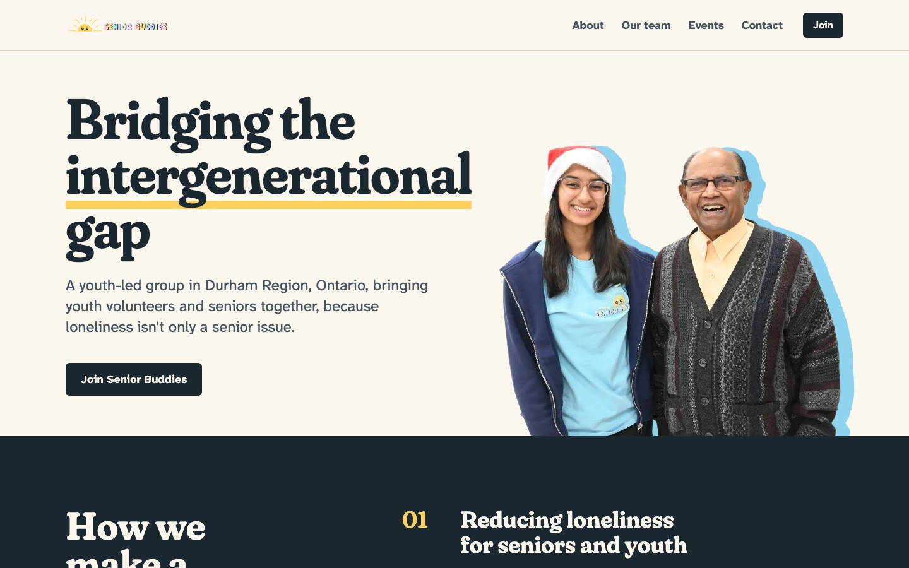
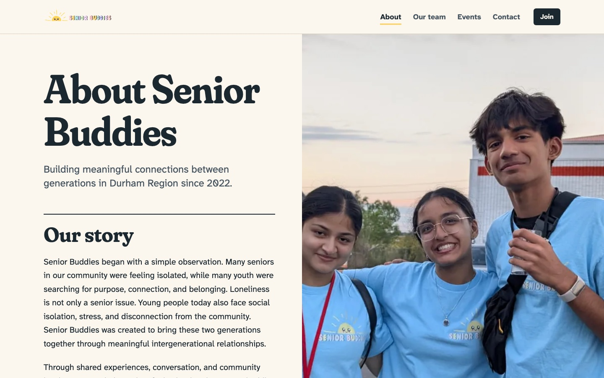
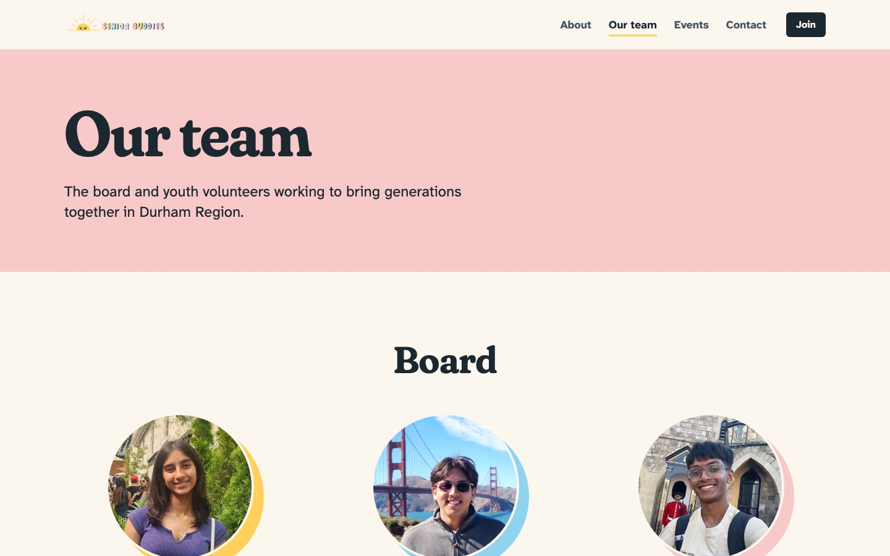
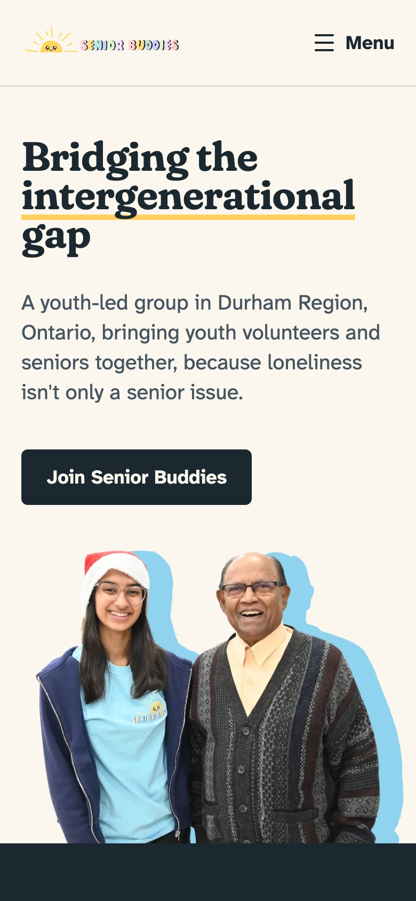
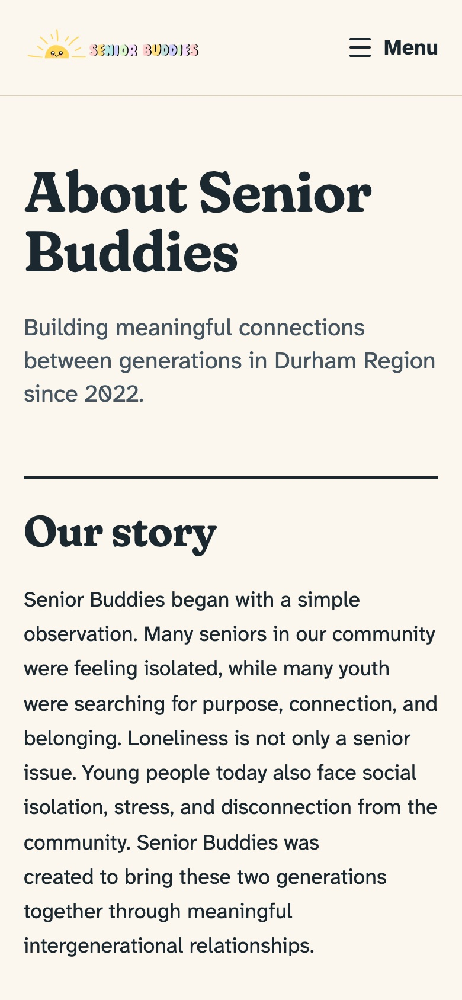

# Senior Buddies

Website for **Senior Buddies**, a youth-led nonprofit in Durham Region, Ontario, that pairs youth volunteers with seniors to reduce loneliness and build connections across generations. The organization has run since 2022.

**Live site:** https://seniorbuddiesdurham.ca



<table>
  <tr>
    <td width="50%"></td>
    <td width="50%"></td>
  </tr>
  <tr>
    <td align="center">About</td>
    <td align="center">Team</td>
  </tr>
</table>

<table>
  <tr>
    <td align="center"><br>Home on a phone</td>
    <td align="center"><br>About on a phone</td>
  </tr>
</table>

## Who it's for

- **Youth volunteers** looking to join and sign up for events
- **Seniors and their families** who want to take part
- **Community partners and donors** learning about the program and team

## My role

I'm a board member of Senior Buddies, and I built and maintain the website: design, React front end, the events list, Netlify Forms for sign-ups, and deployment.

## Features

- **Events list** kept in `src/data/events.ts`, filled in from posts on [our Instagram](https://www.instagram.com/seniorbuddiesdurham/), which is where every event is announced. Events dated today or later show under "Coming up"; the rest move to "Past events" on their own. Each links back to its post.
- **Volunteer, senior and contact forms** handled by Netlify Forms (no backend), with honeypot spam protection.
- **Team page** driven by `src/data/team-members.json`, with WebP photos.
- Responsive layout, keyboard-accessible navigation and forms, reduced-motion support, SEO and Open Graph meta tags, client-side routing.

## Tech stack

| Layer      | Choice                                                  |
| ---------- | ------------------------------------------------------- |
| Framework  | React 19 + TypeScript                                   |
| Build tool | Vite 8                                                  |
| Routing    | React Router 8                                          |
| Styling    | Tailwind CSS 4 + shadcn/ui (Radix) primitives           |
| Forms      | Netlify Forms                                           |
| Hosting    | Netlify (auto-deploys from `main`)                      |
| CI         | GitHub Actions: lint, typecheck, build                  |

## Architecture

```
Browser (React SPA)
   │
   ├── static assets ─────────────► Netlify CDN (dist/)
   │
   └── POST form submissions ─────► Netlify Forms
                                     (forms declared as hidden <form>s in index.html
                                      so Netlify detects them at build time)
```

```
index.html                 HTML shell, meta tags, hidden Netlify form definitions
netlify.toml               Build command, SPA redirect, `netlify dev` settings
public/                    _redirects, favicon, robots.txt
src/
  App.tsx                  Route table
  pages/                   Index, About, Team, Events, Contact, Join, NotFound
  components/              Layout, Navbar, Footer, PageHeader, PhotoStrip, ui/ (shadcn button)
  hooks/use-netlify-form.ts  Submits forms to Netlify
  data/                    events.ts, team-members.json, photos.ts (alt text), site.ts (page names, links)
  assets/                  WebP images
```

## Local setup

Requires Node.js 20.19+ or 22.12+ (see `.nvmrc`) and npm.

```bash
git clone https://github.com/anujmish1229/seniorBuddies.git
cd seniorBuddies
npm install
npm run dev              # http://localhost:8080
```

| Script              | What it does                       |
| ------------------- | ---------------------------------- |
| `npm run dev`       | Vite dev server                    |
| `npm run build`     | Production build into `dist/`      |
| `npm run preview`   | Serve the production build         |
| `npm run lint`      | ESLint                             |
| `npm run typecheck` | TypeScript type check              |

## Adding an event

Open `src/data/events.ts`, copy an entry to the top of the list and fill it in from the Instagram post: title, date (`YYYY-MM-DD`), time, place, a one-line summary and the post link. If the post doesn't give the event date, use the day it was posted and set `postedOnly: true`. Add `register` if there's a sign-up link.

## Environment variables

None. The site has no server code; forms go to Netlify Forms.
